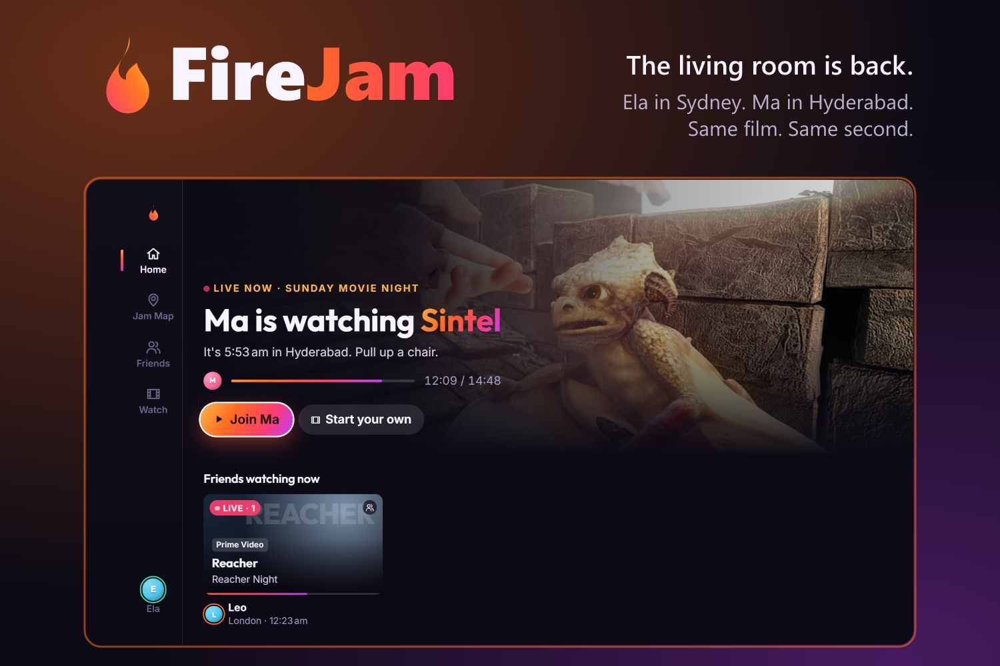
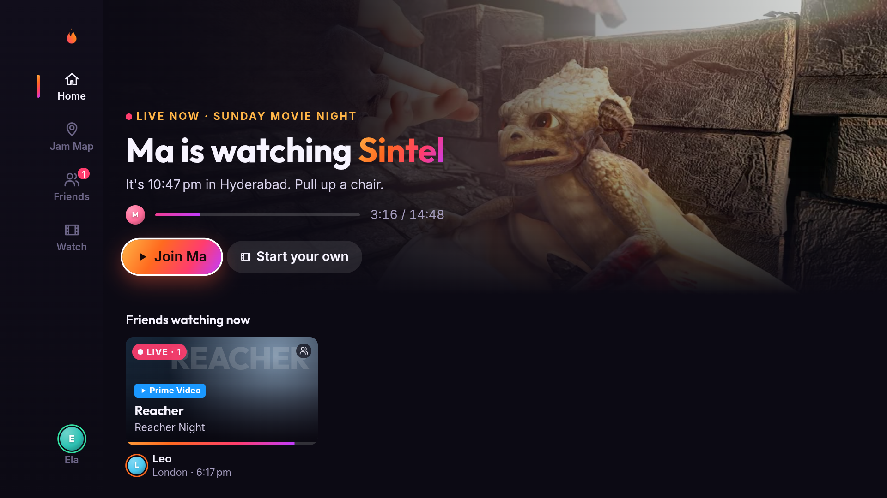
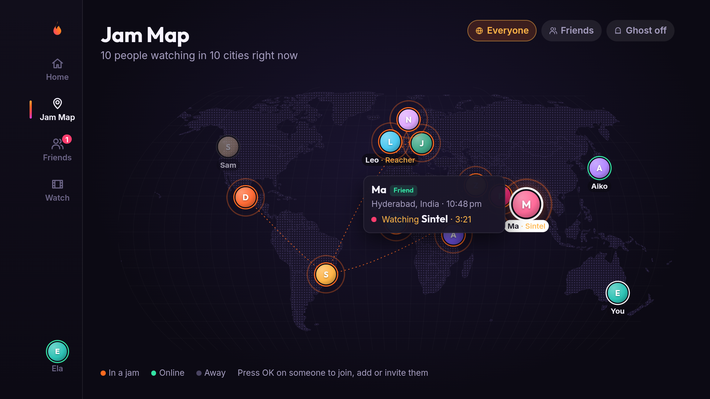
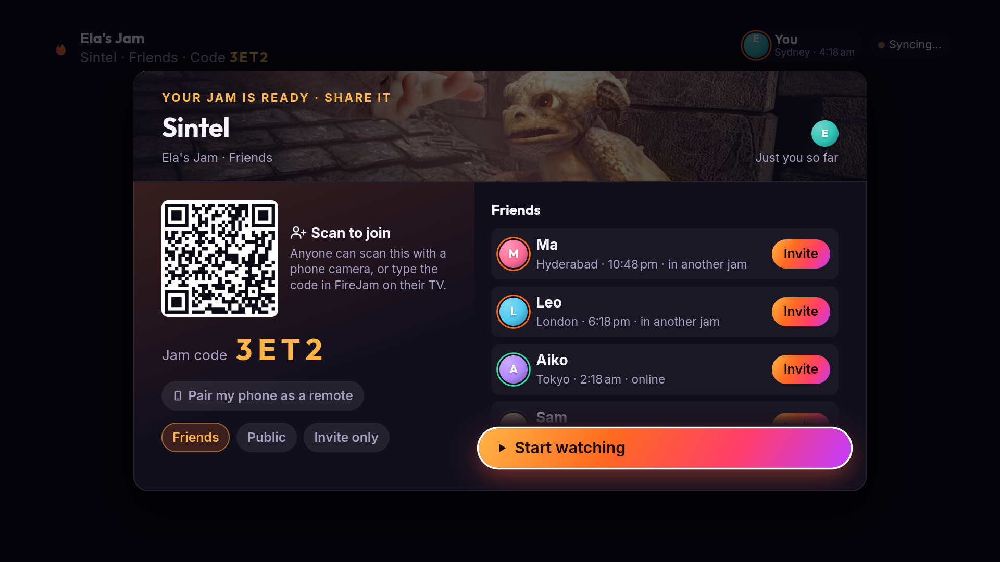
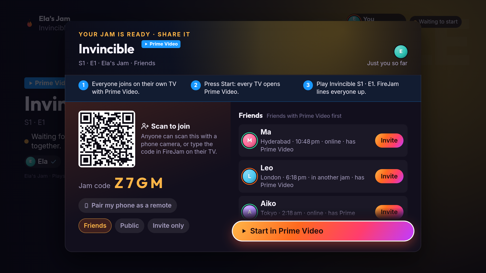
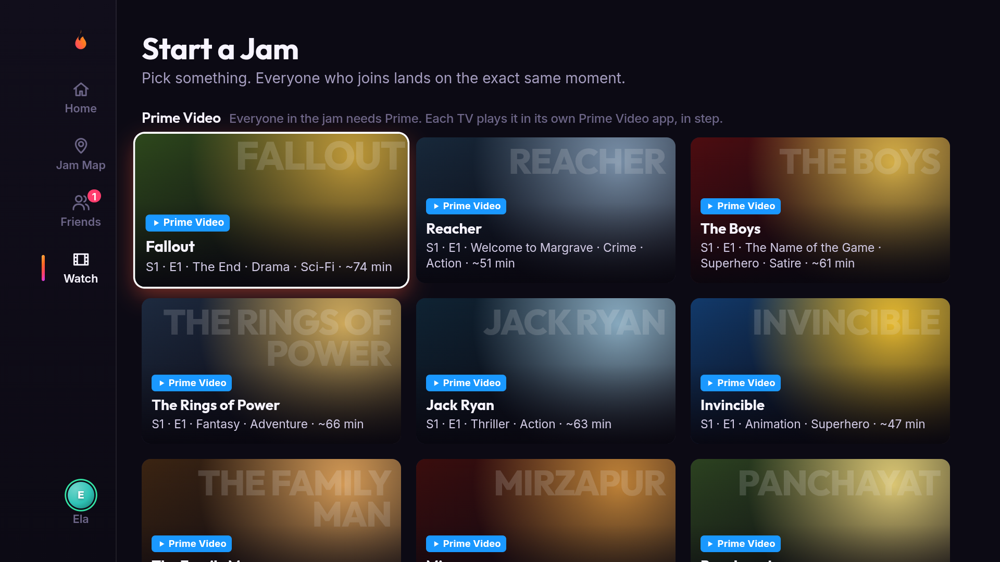
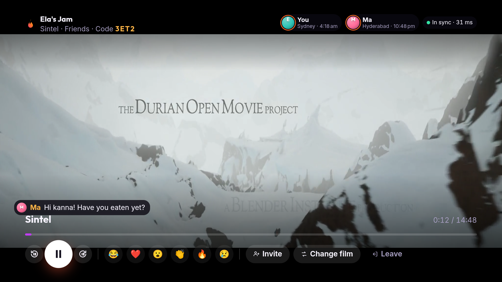

# FireJam 🔥


https://github.com/user-attachments/assets/1c8f86b5-697b-439e-ba3c-3973743d2122


**The living room is back.** FireJam makes watching TV multiplayer again.

**FireJam is Ela's idea.** When Ela was small, Sunday night meant one thing. Ma, Ela, the sofa, one blanket, one TV. Nobody remembers what they watched. Everybody remembers watching it together.

Then they grew up and moved apart. Ma is in Hyderabad. Ela is in Sydney. Same shows, nine thousand kilometres apart, texting "did you see that?" into the dark. We have more screens than ever, and we don't share moments anymore. We share links.

The living room is dead. FireJam brings it back.

FireJam is Spotify Jam for Fire TV. You see what your friends are watching, join them in one click, and land on the exact same frame. Everyone can play, pause and skip, and everyone sees who did it. Reactions float up on every screen, your phone becomes the keyboard, and a Snap-Map-style **Jam Map** shows who's watching what around the world.

> Built for the Amazon Developer Hackathon 2026, **Fire TV track** (family entertainment, multi-modal UX).

## Demo

<!-- Vimeo embed code for HTML pages; GitHub README does not render iframes.
<iframe title="vimeo-player" src="https://player.vimeo.com/video/1238894842?h=40702f1acb" width="640" height="360" frameborder="0" referrerpolicy="strict-origin-when-cross-origin" allow="autoplay; fullscreen; picture-in-picture; clipboard-write; encrypted-media; web-share" allowfullscreen></iframe>
-->
[](https://player.vimeo.com/video/1238894842?h=40702f1acb)

[Watch the FireJam demo on Vimeo](https://player.vimeo.com/video/1238894842?h=40702f1acb)
| Home | Jam Map |
| --- | --- |
|  |  |
| **Share first** | **Prime Video, together** |
|  |  |
| **Prime-first Watch screen** | **Anyone can pause** |
|  |  |

All screenshots were taken on a real Fire TV Stick 4K Max running FireJam against the live AWS server.

---

## What it does

| | |
|---|---|
| **No setup on a Fire TV** | First launch signs you in from what the TV already knows: your first name from the TV's name ("Dhanusha's Fire TV"), your city from its time zone, and Prime Video if it's installed. Profiles stay with the TV they were made on; with more than one, FireJam asks "Who's watching?" like Prime Video does, and "Someone else" only asks for a name. |
| **Follows Fire TV profiles** | Each Fire TV profile is one person in FireJam. The first time someone uses FireJam on their Fire TV profile they pick (or make) their FireJam profile once; after that, switching profiles on the Fire TV switches FireJam at the same moment, including friend pop-ups and what the TV shares about what's playing, even while FireJam is closed. Fire TV doesn't share profile *names* with apps, so a renamed Fire TV profile is renamed in FireJam once, under the profile button → **Name**. |
| **Alexa** | "Alexa, pause", "Alexa, play", "Alexa, rewind 30 seconds", "Alexa, restart": in a FireJam film jam, voice commands drive the whole jam for everyone. In a Prime Video jam Alexa talks to Prime Video, and FireJam carries the result to everyone. |
| **Home** | "Ma is watching *Sintel*. It's 8:42 pm in Hyderabad. Pull up a chair." Friend jams, people, and public jams live from the server. |
| **Jam Map** | A world map with everyone you can see: friends, plus anyone in a public jam. Arcs connect people who are watching together. D-pad from pin to pin, press OK to join, add a friend or invite them. Ghost mode hides your pin. |
| **Friends** | Friend requests, your people (watching / online / last seen), and people online now you can add. |
| **Friend pop-ups** | When a friend starts watching, your Fire TV pops up "🔥 Ma is watching Sintel" over whatever is on, even with FireJam closed, and posts a notification that opens FireJam straight into their jam. Open FireJam screens get a toast. |
| **Friend activity** | For everyone, Prime or not, like Spotify's friend activity: what friends are watching right now (in a jam, or on their own TV in Prime Video, YouTube or any app that publishes a media session) and what they watched recently, with whom. Sharing is on by default and can be switched off in the profile. If a friend is watching a Prime title on their own and you both have Prime, **Watch together** starts a jam at their exact spot and invites them. |
| **Jams** | Start one from any title as *Friends*, *Public* or *Invite only*. Friends walk straight in; everyone else knocks and the host gets a prompt. Starting a jam shows its invite first: a QR code anyone can scan (it opens a join page at `/j/<code>` with the code and how to join from a TV or a browser) and the four-letter code, while the jam waits; **Start watching** (or **Start in Prime Video**) begins it. Invite friends from inside the player too. |
| **Synced player** | Every screen in the jam computes the same playhead from a shared server clock. Anyone can play, pause, skip or change film. "Ma paused ⏸" shows up for everyone. Each member's city and local time sits in the corner, so you always know it's late where Mum is. |
| **Phone companion** | In the Invite sheet, **Pair my phone as a remote** shows a QR code just for you. Your phone (iPhone Safari or any browser) sends reactions and chat (typing on a phone beats typing with a remote) and can play/pause for the room. No app install. |
| **Prime-first Watch screen** | For anyone with Prime Video, the Watch screen leads with 19 Prime Video shows and films (including Indian favourites like The Family Man, Mirzapur and Panchayat), with FireJam's free films below. Without Prime, the free films come first. |
| **Private sign-in** | Everyone's id is visible on the map, so an id alone signs nobody in. A screen needs the profile's secret token (kept by the TV or browser that made it, and carried by the phone QR code) or has to be a Fire TV the profile is bound to. Browsers only offer their own profiles and the demo people. |
| **Prime Video jams** | If you and your friends all have Prime Video, you can jam on Prime titles. Every TV opens the title in its **own** Prime Video app, on its owner's account, and FireJam keeps them in step. Anyone in the jam without Prime can't start, join or be invited, and a jam can't switch to a Prime title until everyone in it has Prime. |

The demo world comes with a small cast (Ma in Hyderabad, Leo in London, a public "Bunny Marathon" running out of São Paulo…) so a fresh install already feels alive. They're clearly tagged **Demo**, they accept friend requests and invites, and they react during the film. Any of them can be "picked up" from the profile screen to drive a second screen in a live demo.

## How it works

```
 Fire TV (Fire OS)                          Laptop / any browser          Phone
 ┌──────────────────────────┐               ┌──────────────────┐         ┌──────────────┐
 │ android/ WebView shell   │               │ same web app     │         │ /m companion │
 │  forwards Back + media   │               │ (?as=ammu to     │         │ reactions,   │
 │  keys to the web app     │               │  play a 2nd user)│         │ chat, ⏯       │
 │ ┌──────────────────────┐ │               └────────┬─────────┘         └──────┬───────┘
 │ │ web/  React TV app   │ │                        │                          │
 │ │ D-pad spatial nav    │ │      Socket.IO         │                          │
 │ │ sync engine + hls.js │◄├────────────────────────┼──────────────────────────┘
 │ └──────────────────────┘ │                        │
 └────────────┬─────────────┘                        ▼
              │                      ┌──────────────────────────────┐
              └─────────────────────►│ server/  Node + Socket.IO    │
                                     │ presence, friends, jams,     │
                                     │ clock, prompts, demo people  │
                                     └──────────────────────────────┘
```

### Sync, in one paragraph

The server keeps each jam as `{ playing, position, updatedAt }` on its own clock and never streams timestamps. Each screen estimates its offset to the server clock NTP-style (lowest-latency samples win) and computes `expected = position + (serverNow − updatedAt)`. Four times a second it compares that to the `<video>`: drift under 40 ms is left alone, drift under 0.7 s is absorbed by nudging `playbackRate` between 0.9× and 1.1× (inaudible), and anything bigger is a seek, aimed ahead by however long seeks have been taking on that device. A slow Fire TV Stick doesn't keep landing behind. In testing two screens settle within ~10–30 ms of each other.

### Prime Video jams

FireJam never streams Prime Video. A Prime jam works like a watch party where everyone brings their own subscription:

1. **Who's allowed.** Each profile says whether it has Prime Video (asked at sign-up, changeable in the profile; on a Fire TV it defaults to on when the Prime Video app is installed). The server enforces the rule everywhere: starting a Prime jam, walking in, knocking, invites, join codes and switching titles. Turning Prime off takes you out of a Prime jam. See `canWatch` in [`shared/playhead.ts`](shared/playhead.ts) and `missingAccess` in [`server/src/hub.ts`](server/src/hub.ts).
2. **Opening it.** On a Fire TV, entering a Prime jam opens the title in Prime Video (`app.primevideo.com/detail?gti=…` links where a title has one, otherwise Prime Video's home screen with an on-screen "find Reacher and press play").
3. **Keeping it in step.** The Fire TV shell reads Prime Video's Android media session once a second and plays, pauses or seeks it to the jam's playhead ([`PrimeSync.kt`](android/app/src/main/java/app/firejam/tv/PrimeSync.kt)). Press pause on your remote while Prime Video is in front and the whole jam pauses.
   **What we measured on a Fire TV Stick 4K Max (Fire OS 8.1.8.5):** Prime Video's session reports playing/paused but keeps its position at 0 and its title empty, and Prime refuses seeks during ads. So FireJam runs "loose" until a session reports a real position: play and pause stay linked both ways, nothing seeks, and the jam clock is shown (on FireJam's screen and in the bubbles over Prime, e.g. "Leo paused ⏸ · jam at 12:34") so people line up once by hand. Where a player does report its position, drift over 2 s is a seek aimed ahead by the measured seek time, backing off when seeks are refused.
4. **Staying social.** Reactions, chat and "Ma paused ⏸ · jam at 12:34" are drawn as bubbles on top of Prime Video ([`JamOverlay.kt`](android/app/src/main/java/app/firejam/tv/JamOverlay.kt)).
5. **Staying connected.** Fire OS freezes a hidden WebView's timers (measured: a 1 s timer didn't fire within 60 s), so while Prime Video is in front the native app talks to the server itself: it polls `GET /api/tv/jam` once a second for the jam, the server clock and a feed of what happened, and sends remote presses to `POST /api/tv/control`. A foreground service keeps the process alive.

In a browser there's no Prime Video to drive, so a Prime jam page becomes the jam's remote: timeline, play/pause/skip for everyone, reactions and chat.

**One-time Fire TV setup for Prime jams.** Android only lets an app follow another app's playback if it's an enabled notification listener, and Fire TV has no settings screen for that, so grant it (and "display over other apps") once over adb:

```bash
adb shell cmd notification allow_listener app.firejam.tv/app.firejam.tv.PrimeSessionListener
adb shell appops set app.firejam.tv SYSTEM_ALERT_WINDOW allow
```

**Limits, honestly.** "Has Prime" is what the person says; there's no public API to check a Prime membership, so a viewer without one simply can't play the title in their own Prime Video app. Prime titles in this demo have no `gti` links yet (fill `PRIME_LINKS` in [`server/src/catalog.ts`](server/src/catalog.ts)), so viewers pick the title in Prime Video themselves. Runtimes are estimates, so the playhead is never clamped for service titles. The media-session approach is reported to work with Prime Video on Fire OS 7, but Amazon doesn't document it, so test it on your device.

### Friend activity

Every jam leaves a history entry for each person in it ("watched Big Buck Bunny with Ma · yesterday"). Outside FireJam, the Fire TV shell watches the TV's active media session from a background listener ([`ActivityReporter.kt`](android/app/src/main/java/app/firejam/tv/ActivityReporter.kt)) and reports the app, title and position to `POST /api/activity` with a per-person token, so friends see "Aiko is watching Fallout on Prime Video" even when FireJam isn't open. Friends see it; strangers never do; switching sharing off hides both now-playing and history. It uses the same one-time listener grant as Prime Video jams.

### Prime Video on a Windows PC

A laptop can be a full member of a Prime jam too. The Prime Video app for Windows reports its playback (title included) to Windows' media controls, so [`desktop/prime-sync/bridge.mjs`](desktop/prime-sync/bridge.mjs) does for a PC what the Fire TV app does for a TV, through [`smtc.ps1`](desktop/prime-sync/smtc.ps1):

```bash
node desktop/prime-sync/bridge.mjs --link "<the phone link from FireJam's Invite screen>"
```

The phone link (the QR code on the Invite screen) carries your profile's id and its secret token, which is what lets the bridge act as you.

Measured with the real Prime Video app: a pause from another screen paused the PC within a second, a skip in the jam moved the PC's Prime to the same spot (within 1.5 s), and pausing in Prime on the PC paused the jam for everyone. Same rules as the TV: the jam waits during the PC's ads.

### D-pad navigation

There are no hand-wired focus maps. Every focusable element carries `data-focus`; arrow keys pick the nearest element in that direction by on-screen geometry, preferring the same row or column. Dialogs are `data-trap` containers, and the side rail and main stage are `data-group`s so Down from a row of cards finds the next row, not the rail. The Android shell forwards Back and the media keys (which a WebView doesn't pass to JavaScript) through `window.firejamBack()` / `window.firejamKey()`. See [`web/src/lib/nav.ts`](web/src/lib/nav.ts).

Everything is sized in `rem` with `1rem = 1/120` of the viewport width, so one layout fits the Fire TV WebView (960×540 CSS px at 2×), a 4K panel and a laptop.

### Built for Fire TV

Measured on a Fire TV Stick 4K Max (Fire OS 8) and tuned against [Amazon's Fire TV design guidelines](https://developer.amazon.com/docs/fire-tv/design-and-user-experience-guidelines.html):

- **Idle screens draw nothing.** Progress bars used to animate `width`, which re-laid out the page every frame, and decorative loops (live dots, map arcs, pulsing pins) kept the TV redrawing at 60 fps. Idle CPU went from 58% to 8% of a core on Home and from 128% to 19% on the Jam Map. Loops now run a few times and stop; bars move with `transform`.
- **Smooth D-pad.** The map is its own compositing layer, so moving between pins no longer re-rasterises the world (dropped frames per press went from ~130 ms to none). Home, Friends and Watch hold 60 fps while navigating.
- **Readable from the sofa.** Body text is at least 1.75rem (28 px at 1080p, Amazon's 14sp minimum), and every focusable item and line of text sits inside the 90% safe zone (6rem from the sides, 3.4rem from top and bottom), since TVs may crop the outer 5%.
- **Fire TV's remote and keyboard.** Back closes sheets, leaves screens and exits from Home; Left from content lands on the current screen's item in the side rail, and Right returns to where you were. Typing a jam code on Fire TV's full-screen keyboard joins on the fourth character.
- **Fast starts.** Vite's fingerprinted assets are served `immutable` for a year, so after the first launch a TV only fetches the small `index.html`. Cold start to first paint is about 1.3 s over CloudFront.
- **Alexa transport controls** through a media session ([`VoiceControl.kt`](android/app/src/main/java/app/firejam/tv/VoiceControl.kt), with `com.amazon.permission.media.session.voicecommandcontrol`). Fire OS also sends "pause" to the app in front when you press Home; FireJam ignores those, so leaving the TV doesn't pause the jam for everyone else.
- **Fire TV profiles** have no public API (the switch broadcast needs an Amazon-only permission), but the active profile's id is in secure settings (`cev_pid`) and changes the moment someone switches. FireJam hashes it with the TV's id (the server never sees Amazon's ids), watches it, and keeps one FireJam identity per Fire TV profile ([`Identity.kt`](android/app/src/main/java/app/firejam/tv/Identity.kt)).

## Run it

Requires Node 20+.

```bash
npm install
npm run dev          # server on :3000, TV app on :5173 (Vite)
```

Open http://localhost:5173 and use the arrow keys, Enter and Escape (Back). To play a second person on the same machine, open another window at `http://localhost:5173/?as=ammu`.

```bash
npm test             # boots a throwaway server and runs two clients through friends, knocks and shared playback
```

Production (one port, what the Fire TV loads):

```bash
npm run build        # builds web/dist
npm start            # serves the app + realtime server on :3000
```

The server prints its LAN address on start, e.g. `LAN: http://192.168.1.3:3000`.

Optional: `npm run media:fetch -w server` downloads the four films (~550 MB) into `server/media/` and the server then streams them locally, which makes LAN demos instant to seek.

## Runs on AWS

FireJam's server is hosted on AWS so friends on any network (a mum in Hyderabad, a kid in Sydney) share one jam. The hackathon deployment is live at **https://d12le9d1o14nhz.cloudfront.net** (Sydney region), and the Fire TV build points there by default. [`deploy/aws/deploy.sh`](deploy/aws/deploy.sh) sets it all up with the AWS CLI and re-running it ships a new release:

| AWS service | What FireJam uses it for |
|---|---|
| **Amazon EC2** (Graviton `t4g.micro`, Amazon Linux 2023) | Runs the Node + Socket.IO server under systemd ([`user-data.sh`](deploy/aws/user-data.sh)). |
| **Amazon CloudFront** | HTTPS and WebSockets for every TV, phone and browser at `https://<id>.cloudfront.net`; the instance only accepts traffic from CloudFront's origin-facing prefix list. |
| **Amazon S3** | Release tarballs the instance pulls on boot and on each deploy. |
| **AWS Systems Manager** | Ships new releases to the instance (`send-command`), no SSH or open ports. |
| **AWS IAM** | Instance role scoped to reading releases and calling Bedrock. |
| **Amazon Bedrock** (Amazon Nova Lite, Converse API) | **✨ Pick for us**: chooses what the jam watches next from what everyone can watch (Prime rules apply), what they watched lately and each person's local time, e.g. "It's 11:40 pm in Hyderabad, so something short". See [`server/src/pick.ts`](server/src/pick.ts); without Bedrock it falls back to a time-of-day rule. |

```bash
aws login                       # AWS CLI v2.32+, signs in with your console session
bash deploy/aws/deploy.sh       # prints https://<id>.cloudfront.net when done
adb shell am start -n app.firejam.tv/.MainActivity --es server https://<id>.cloudfront.net
```

Verified end to end on a Fire TV Stick 4K Max: the TV signs in, plays a jam in sync (30–100 ms), and follows pause/play and chat sent from another screen through CloudFront WebSockets. Running cost is roughly US$10/month (t4g.micro, public IPv4, a little CloudFront and S3). Brand-new AWS accounts can't call Bedrock until AWS finishes verifying them; until then "Pick for us" uses its time-of-day fallback.

## Install it on any TV

Open **https://d12le9d1o14nhz.cloudfront.net/get** for step-by-step instructions:

- **Android TV / Google TV** (Sony, TCL, Mi, OnePlus, Philips, Hisense…) **and Fire TV:** install the free *Downloader* app from the TV's store and enter `https://d12le9d1o14nhz.cloudfront.net/firejam.apk`. Every deploy ships the latest TV app at that address. On Android TVs, FireJam's Home screen walks through two switches with an **Open Settings** banner, one at a time: *Notification access* (Prime sync and sharing what's on) and *Display over other apps* (friend pop-ups, since TVs don't pop notifications up). Fire TV has neither screen, so it uses the adb commands below.

  Tested on a Google TV (Android 11) emulator with only the remote: install, making a profile with the TV keyboard (no TV name to borrow, so it asks), both Settings switches, a film jam with a friend on another screen (pause, seek, reactions, chat, invites, changing film, voice commands through the media session), Prime titles locked without Prime Video, and a friend's pop-up over the Google TV home screen.
- **Samsung (Tizen) / LG (webOS):** these can't install outside apps; open the address in the TV's web browser. Films, chat, reactions and friends work; Prime jams need an Android TV, a Fire TV Stick or a Windows PC.

## Run it on a Fire TV

1. On the Fire TV: **Settings → My Fire TV → Developer options** → turn on **ADB debugging** and **Apps from unknown sources**. Note its IP under **Settings → My Fire TV → About → Network**.
2. Put your computer's LAN address in `android/gradle.properties` (`firejamUrl=http://<your-ip>:3000`), or change it later on the TV by holding the **Menu** button.
3. Build and install. The project uses Android Gradle Plugin 8.2.2, Gradle 8.2.1, and Kotlin 1.9.22. Use JDK 17 and an Android SDK with platform 34 and build-tools 34.0.0 (Android Studio's SDK works). Compile and target API are 34; min API stays 22 (Fire OS 5). Put the SDK path in `android/local.properties` as `sdk.dir=…`, then in PowerShell:

```powershell
cd android
$env:JAVA_HOME = '<path to JDK 17>'
.\gradlew.bat assembleDebug
adb connect <fire-tv-ip>:5555
adb install -r app/build/outputs/apk/debug/app-debug.apk
```

On Windows, allow Node.js through the firewall when asked, or the Fire TV can't reach the server on port 3000.

For Prime Video jams, also run the two one-time `adb shell` grants from [Prime Video jams](#prime-video-jams).

FireJam appears in **Your Apps & Channels**. Remote mapping: D-pad moves, Select chooses, Back goes back (Back on the player asks before leaving the jam), ⏯ / ⏪ / ⏩ control the jam from anywhere, and in the player Left/Right skip 10 s.

Debug the TV build from desktop Chrome at `chrome://inspect` (WebView debugging is on).

## Project layout

```
shared/protocol.ts     wire types used by server and clients
shared/playhead.ts     playhead and "who can watch what" rules, shared by server and clients
server/src/
  hub.ts               presence, friends, jams, prompts, playback control, Prime access rules
  bots.ts              the demo cast and how they behave
  catalog.ts           titles: Blender open movies (CC-BY) + Prime Video titles
  places.ts            cities, coordinates and time zones
  store.ts             JSON persistence for real profiles
  index.ts             Express + Socket.IO wiring
web/src/
  lib/nav.ts           D-pad spatial navigation + remote key handling
  lib/store.ts         client state, server clock, socket events
  screens/             Onboarding, Home, MapScreen, Friends, Library, Player, PrimeStage
  lib/native.ts        bridge to the Fire TV shell (Prime Video open/sync/overlay)
  companion/           phone companion (/m)
android/               Fire OS WebView shell (Kotlin): remote keys, Prime Video launch, media-session sync, overlay
docs/                  demo script and hackathon submission notes
```

## What's next

- **More services.** Prime Video jams already sync each viewer's own app through its media session. The same path works for any Fire TV app that publishes one, with the same "everyone needs it" rule.
- **Title links.** Real `gti` deep links for the whole Prime catalogue, so every TV lands on the right title without searching.
- **"Alexa, start a jam with Mum."** Voice is the most natural remote for the people FireJam is for. An Alexa+ integration would start, join and invite by voice.
- **Talk while you watch.** Push-to-talk through the phone companion, ducking the film's audio while someone speaks.
- **Real accounts.** Login with Amazon, contact-based friend discovery, and abuse controls before public jams go beyond a demo.

## Credits

Films by the Blender Foundation under Creative Commons Attribution: *Sintel* (durian.blender.org), *Big Buck Bunny* (bigbuckbunny.org), *Tears of Steel* (mango.blender.org), *Elephants Dream* (orange.blender.org). Streams via the Internet Archive and Mux's public test streams. World map from Natural Earth via `world-atlas`.

## License

MIT, see [LICENSE](LICENSE).
